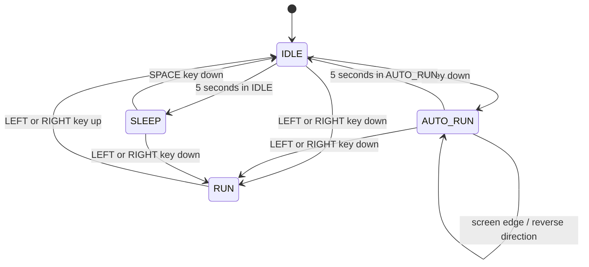

# 캐릭터 자동 달리기 기능 PRD

## 1. 문서 목적

`PRE-PRD.md`의 요구사항을 바탕으로 Python 캐릭터 이동 애니메이션에 자동 달리기 기능을 추가한다. 기존 수동 이동과 대기·수면 동작을 유지하면서, `AutoRun` 상태 클래스를 통해 자동 이동의 진입·동작·종료를 구현한다.

이 문서는 구현 범위, 상태 전환 규칙, 완료 기준과 단계별 개발 계획을 정의한다. 문서의 작성만으로 기능 구현이나 커밋이 완료된 것으로 간주하지 않는다.

## 2. 현재 프로젝트

| 항목 | 현재 구성 |
| --- | --- |
| 개발 언어 | Python |
| 사용 라이브러리 | `pico2d`, `transitions` |
| 실행 진입점 | `main.py` |
| 캐릭터 구현 | `boy.py`의 `Boy` 클래스 |
| 상태 관리 | `transitions.Machine`, `IDLE`·`RUN`·`SLEEP` |
| 일반 이동 속도 | 업데이트당 5픽셀 |
| 기본 캐릭터 크기 | 100 × 100픽셀 |
| 화면 경계 기준 | 너비 800픽셀, 기본 캐릭터 중심 x 범위 50~750 |
| 기존 상태 문서 | `state_machine.md` |

현재 캐릭터는 IDLE에서 5초가 지나면 SLEEP으로 전환한다. 좌우 방향키로 RUN에 진입하며, RUN에서 방향키를 놓으면 IDLE로 돌아간다. SLEEP에서는 Space로 IDLE에 복귀하거나 좌우 방향키로 RUN에 진입한다.

## 3. 목표와 범위

### 목표

- IDLE에서 A 키를 누르면 키를 계속 누르지 않아도 자동으로 달린다.
- 자동 달리기 중에는 일반 RUN보다 빠르게 움직이고 크게 표시된다.
- 화면 좌우 경계에서 방향을 바꾸며 화면 안에서 왕복한다.
- 좌우 방향키 입력 또는 진입 후 5초 경과로 자동 달리기를 종료한다.
- 최종 상태 다이어그램을 이미지 파일로 저장소에 추가한다.
- 작업을 작은 단위로 나누어 약 20회 커밋한다.

### 구현 범위

- `AutoRun` 상태 클래스 추가 및 기존 상태 머신과 연결
- 입력 처리, 이동, 애니메이션, 크기, 경계 처리, 타이머 구현
- 기존 IDLE·RUN·SLEEP 및 프로그램 종료 동작 유지
- 상태 문서 갱신과 다이어그램 이미지 추가

새 캐릭터, 신규 이미지 제작, 점프, 점수, 사운드, 스테이지 확장은 이번 범위에 포함하지 않는다.

## 4. 기능 요구사항

| ID | 요구사항 | 상세 동작 |
| --- | --- | --- |
| FR-01 | 자동 달리기 진입 | IDLE에서 `SDL_KEYDOWN`의 A 키 입력을 받으면 AUTO_RUN에 진입한다. A 키를 놓아도 계속 이동한다. |
| FR-02 | 상태 클래스 | 이름이 `AutoRun`인 별도 클래스를 추가한다. 상태 이름이나 조건문만 추가하는 것으로 대체하지 않는다. |
| FR-03 | 자동 이동 | 진입 직전 캐릭터가 바라보던 좌우 방향을 유지하며, 입력 없이 매 업데이트 이동한다. |
| FR-04 | 속도 증가 | AUTO_RUN의 이동 속도는 일반 RUN보다 커야 한다. 일반 RUN의 기준 속도는 유지한다. |
| FR-05 | 크기 확대 | AUTO_RUN에서는 캐릭터의 가로·세로 크기를 같은 배율로 확대하며 달리기 애니메이션을 재생한다. |
| FR-06 | 경계 반전 | 확대된 캐릭터의 좌우 끝이 화면 경계에 도달하면 위치를 화면 안으로 보정하고 진행 방향과 애니메이션 방향을 반전한다. |
| FR-07 | 수동 이동 전환 | AUTO_RUN에서 왼쪽 또는 오른쪽 방향키를 누르면 즉시 RUN으로 전환하고, 눌린 키 방향으로 이동한다. |
| FR-08 | 시간 종료 | AUTO_RUN 진입 이후 실제 경과 시간이 5초 이상이면 IDLE로 전환하고 이동을 멈춘다. |
| FR-09 | 일반 상태 복원 | AUTO_RUN에서 나갈 때 확대 표시와 자동 이동 효과를 해제한다. 이후 RUN은 기본 속도·기본 크기로, IDLE은 기본 크기로 동작한다. |
| FR-10 | 재진입 | IDLE에서 A 키를 다시 누르면 새로운 5초 타이머로 AUTO_RUN을 시작한다. |
| FR-11 | 기존 동작 유지 | 기존 수동 이동, 수면, 깨우기, Escape 및 창 닫기 동작이 유지되어야 한다. |
| FR-12 | 결과 문서화 | 최종 상태 전환을 `state_machine.md`에 반영하고, 동일한 내용을 담은 다이어그램 이미지 파일을 저장소에 추가한다. |

## 5. 세부 동작 규칙

다음 규칙은 원문에 없는 세부사항을 명확히 하기 위한 기본 설계안이다.

### 5.1 입력과 우선순위

- 자동 달리기를 시작하는 방향키는 좌우 방향키로 한정한다. 위·아래 방향키는 자동 달리기를 취소하지 않는다.
- RUN 또는 SLEEP에서 A 키를 눌러도 AUTO_RUN에 진입하지 않는다.
- AUTO_RUN에서 A 키를 다시 누르거나 키 반복 이벤트가 발생해도 타이머를 초기화하지 않는다.
- A 키를 계속 누른 상태에서 시간 종료되어 IDLE에 돌아오더라도 자동으로 재진입하지 않는다. 다시 진입하려면 A 키를 놓았다가 새로 눌러야 한다.
- AUTO_RUN 중 A 키나 좌우 방향키의 키 해제 이벤트만으로는 자동 달리기를 취소하지 않는다.
- AUTO_RUN에서 방향키를 눌러 RUN에 진입한 뒤 해당 키를 놓으면 기존 규칙대로 IDLE로 전환한다.
- 같은 이벤트 처리 주기에 좌우 방향키 누름이 여러 번 있으면 마지막으로 처리한 키 방향을 사용한다.
- 방향키 누름과 5초 만료가 같은 프레임에 발생하면 방향키 입력을 우선한다. 입력 처리로 RUN에 전환한 뒤에는 이전 AUTO_RUN 타이머가 상태를 바꾸지 않는다.

### 5.2 속도와 표시 크기

`PRE-PRD.md`에는 증가 배율이 없으므로 아래 값은 구현을 위한 제안값이다. 상수로 관리하여 조정할 수 있게 한다.

| 항목 | 제안값 | 필수 조건 |
| --- | --- | --- |
| 자동 달리기 속도 | 일반 RUN의 2배, 현재 기준 업데이트당 10픽셀 | 일반 RUN보다 빠를 것 |
| 자동 달리기 표시 크기 | 기본 크기의 1.5배, 150 × 150픽셀 | 기본 크기보다 크고 가로·세로 비율이 같을 것 |
| 자동 달리기 지속 시간 | 5.0초 | 실제 경과 시간이 5초 이상인 첫 업데이트에 종료할 것 |

확대·복원 시 발 위치를 유지하도록 그리기 중심을 보정한다. 이동 방향이 바뀌면 해당 방향의 기존 달리기 스프라이트를 사용한다.

### 5.3 경계 처리

- 유효한 캐릭터 중심 범위는 `표시 너비 / 2`부터 `화면 너비 - 표시 너비 / 2`까지다.
- 제안 크기 150픽셀과 화면 너비 800픽셀을 적용하면 AUTO_RUN의 중심 범위는 x=75~725다.
- 다음 이동 위치가 경계를 넘으면 경계로 보정하고 반대 방향을 설정한다. 다음 업데이트부터 반대편으로 이동한다.
- AUTO_RUN 진입 시 확대 때문에 경계를 벗어날 경우 즉시 유효 범위로 보정한다. 경계에서 바깥쪽을 향하고 있다면 안쪽으로 방향을 바꾼다.
- 경계에서 반복 반전하며 멈추거나 떨리는 현상이 없어야 한다.

### 5.4 시간 처리

- `time.monotonic()`을 사용하여 프레임 수와 독립적으로 시간을 측정한다.
- AUTO_RUN 진입마다 시작 시간을 새로 기록하고, 경계 반전에서는 시간을 초기화하지 않는다.
- 시간 종료 후 IDLE의 기존 수면 타이머를 새로 시작한다. 이후 입력 없이 IDLE에서 추가로 5초가 지나면 SLEEP으로 전환한다.

## 6. 상태 전환 명세

| 현재 상태 | 이벤트·조건 | 다음 상태 | 처리 |
| --- | --- | --- | --- |
| IDLE | A 키 누름 | AUTO_RUN | 타이머 시작, 확대, 자동 이동 시작 |
| IDLE | 좌우 방향키 누름 | RUN | 입력 방향 설정 |
| IDLE | 대기 5초 이상 | SLEEP | 기존 수면 동작 |
| RUN | 좌우 방향키 누름 | RUN | 입력 방향 갱신 |
| RUN | 좌우 방향키 해제 | IDLE | 기존 정지 동작 |
| AUTO_RUN | 좌우 경계 도달 | AUTO_RUN | 위치 보정, 방향 반전, 타이머 유지 |
| AUTO_RUN | 좌우 방향키 누름 | RUN | 자동 달리기 효과 해제, 입력 방향 설정 |
| AUTO_RUN | 진입 후 5초 이상 | IDLE | 자동 달리기 효과 해제, 이동 정지, IDLE 타이머 시작 |
| SLEEP | Space 키 누름 | IDLE | 기존 깨우기 동작 |
| SLEEP | 좌우 방향키 누름 | RUN | 기존 수동 이동 동작 |

위 도식은 구현 기준이다. 최종 산출물에는 Markdown 도식과 별도로 열어서 확인할 수 있는 이미지 파일이 필요하다.

## 7. 구현 구조와 산출물

- `boy.py`: A 키 입력과 상태 전환을 연결하고, 기존 수동 이동과 표시 처리를 통합한다.
- `AutoRun` 클래스: 진입 시 타이머와 확대 설정, 업데이트 시 이동·반전·만료 판정, 종료 시 일반 표시 복원을 담당한다. `boy.py` 내부 또는 별도 모듈에 둘 수 있다.
- `transitions.Machine`: 기존 상태 관리를 유지하며 `AUTO_RUN` 상태의 진입·갱신·종료를 `AutoRun` 클래스에 연결한다. 기존 상태 전체를 클래스 방식으로 재작성할 필요는 없다.
- `main.py`: 현재의 이벤트 처리 → 업데이트 → 렌더링 순서를 유지한다.
- `state_machine.md`: 최종 전환 규칙과 이미지 경로를 기록한다.
- `images/state_machine.png`: 최종 상태 다이어그램 이미지의 권장 저장 경로다. 모든 상태와 전환 조건을 읽을 수 있어야 한다.
- 기존 이미지 리소스를 재사용하며, 새 라이브러리는 필요한 경우에만 추가한다.

## 8. 검수 기준

| ID | 확인 절차 | 기대 결과 |
| --- | --- | --- |
| AC-01 | IDLE에서 A를 누른 뒤 놓는다. | AUTO_RUN에 진입하고 추가 입력 없이 계속 달린다. |
| AC-02 | 같은 업데이트 횟수 동안 RUN과 AUTO_RUN의 이동량을 경계 밖 구간 없이 비교한다. | AUTO_RUN의 이동량이 더 크다. 제안값 적용 시 2배다. |
| AC-03 | AUTO_RUN의 표시 크기와 애니메이션을 확인한다. | 비율을 유지하며 확대되고, 발 위치를 유지한 채 진행 방향으로 달린다. |
| AC-04 | AUTO_RUN으로 오른쪽·왼쪽 경계에 각각 도달한다. | 화면 밖으로 나가지 않고 두 경계에서 자동 반전한다. |
| AC-05 | 기본 크기의 캐릭터를 경계에 둔 뒤 바깥 방향을 보며 A를 누른다. | 확대 직후 위치를 보정하고 안쪽으로 이동한다. |
| AC-06 | AUTO_RUN 중 왼쪽 또는 오른쪽 키를 각각 누른다. | 즉시 해당 방향의 RUN으로 전환하며 기본 크기와 속도로 돌아온다. |
| AC-07 | AC-06 이후 눌렀던 방향키를 놓는다. | IDLE로 전환하고 이동을 멈춘다. |
| AC-08 | AUTO_RUN 진입 후 입력 없이 시간을 측정한다. | 5초 미만에는 유지되고, 5초 이상인 첫 업데이트에 IDLE로 돌아온다. |
| AC-09 | AUTO_RUN 중 경계 반전 또는 A 키 반복 입력을 발생시킨다. | 최초 진입 시점 기준으로 5초 만료가 유지된다. |
| AC-10 | 시간 종료와 같은 프레임에 좌우 방향키 누름을 처리한다. | RUN으로 전환하며 이전 타이머 때문에 IDLE로 바뀌지 않는다. |
| AC-11 | 시간 종료 후 A를 놓았다가 다시 누른다. | 새 AUTO_RUN이 시작되고 새로 5초가 주어진다. |
| AC-12 | A를 계속 누른 채 AUTO_RUN의 시간 종료를 기다린다. | IDLE에 도달하며 키 반복 입력으로 재진입하지 않는다. |
| AC-13 | RUN·SLEEP에서 A를 누르고, AUTO_RUN에서 A·방향키를 놓거나 위·아래 키를 누른다. | 정의되지 않은 상태 전환이나 타이머 초기화가 발생하지 않는다. |
| AC-14 | 자동 달리기 종료 후 입력 없이 IDLE에서 5초 더 기다린다. | 기존 규칙에 따라 SLEEP으로 전환한다. |
| AC-15 | 기존 좌우 이동, 수면, Space 깨우기, Escape, 창 닫기를 확인한다. | 기존 동작이 정상 작동한다. |
| AC-16 | 코드와 최종 상태 문서·이미지를 확인한다. | `AutoRun` 클래스가 실제 사용되고, 다이어그램이 구현의 전환 조건과 일치한다. |

시간 검증은 프레임 수 대신 단조 시계 기준으로 수행한다. 이동·표시·경계는 실행 화면으로 확인하고, 타이머 경계와 입력 우선순위는 필요시 제어된 시간·이벤트로 검증한다.

## 9. 단계별 개발 및 커밋 계획

한 번에 전체 기능을 완성하지 않고, 각 단계의 변경과 확인을 마친 뒤 커밋한다. 아래 약 20회 계획을 기준으로 진행하되, 횟수만 맞추기 위한 빈 커밋은 만들지 않는다.

| 순서 | 작업 단위 | 완료 확인 |
| --- | --- | --- |
| 1 | PRD 작성 | 요구사항·제안값·검수 기준 확인 |
| 2 | 기존 상태와 실행 절차 정리 | IDLE·RUN·SLEEP 기준 동작 확인 |
| 3 | 속도·크기·지속 시간 상수 정리 | 기존 동작 유지 확인 |
| 4 | `AutoRun` 클래스 골격 추가 | 클래스 로드 가능 확인 |
| 5 | 상태 머신에 AUTO_RUN 등록 | 진입·갱신·종료 연결 확인 |
| 6 | IDLE의 A 키 진입 처리 | IDLE에서만 진입 확인 |
| 7 | A 키 반복·재입력 처리 | 반복 진입 및 타이머 재시작 방지 확인 |
| 8 | 기존 바라보는 방향 계승 | 좌우 각각 진입 확인 |
| 9 | 입력 없는 자동 이동 구현 | A 키 해제 후 이동 지속 확인 |
| 10 | 자동 이동 속도 증가 | 일반 RUN과 이동량 비교 |
| 11 | 자동 달리기 애니메이션 연결 | 양방향 프레임 재생 확인 |
| 12 | 확대 표시 및 발 위치 보정 | 크기·비율·지면 위치 확인 |
| 13 | 확대 기준 경계 계산·진입 보정 | 화면 가장자리 진입 확인 |
| 14 | 좌우 경계 방향 반전 | 양쪽 반전과 이동 재개 확인 |
| 15 | 방향키로 RUN 전환 | 입력 방향·키 해제 동작 확인 |
| 16 | 단조 시계 기반 5초 종료 | 만료 시점·입력 우선순위 확인 |
| 17 | 종료 복원·재진입 처리 정리 | 크기·속도·타이머 복원 확인 |
| 18 | 전체 검수 및 발견 문제 수정 | AC-01~AC-15 확인 |
| 19 | 최종 상태 문서와 이미지 추가 | 전환 명세·이미지 가독성 확인 |
| 20 | 최종 코드·산출물 정리 | AC-16 및 저장소 변경 내역 확인 |

## 10. 완료 조건

- 기능 요구사항 FR-01~FR-12와 검수 기준 AC-01~AC-16을 충족한다.
- `python main.py`로 실행할 수 있으며 기존 기능이 유지된다.
- 이름이 `AutoRun`인 상태 클래스가 실제 자동 달리기 동작에 사용된다.
- 상태 다이어그램 이미지가 저장소에 포함되고 문서에서 경로를 안내한다.
- 약 20회의 의미 있는 단계별 커밋으로 개발 과정을 남긴다.
- 사용한 속도·확대 배율이 문서와 일치하도록 제안값을 확정하거나 문서를 갱신한다.
