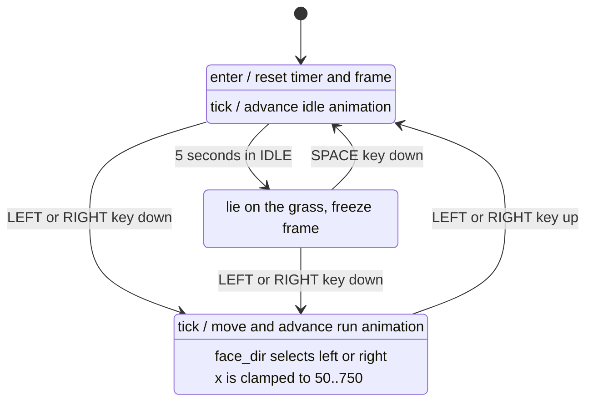

# Boy state machine



The boy starts in `IDLE`. A monotonic clock measures five seconds from
each entry into `IDLE`, independently of the frame rate. Once the time
expires, `tick()` changes the state to `SLEEP`.

In `SLEEP`, the sprite is rotated onto its side and its animation is frozen.
Pressing SPACE returns to `IDLE` and starts a fresh five-second timer.
SPACE during `IDLE` does not reset the timer.

Pressing LEFT or RIGHT while in `IDLE` or `SLEEP` changes the state to the
single `RUN` state. `face_dir` chooses the direction and sprite row without
creating separate left and right states. Releasing an arrow key returns to `IDLE`, which restarts
the five-second sleep timer. The boy's center is clamped from x=50 through
x=750 so the 100-pixel-wide sprite remains completely on the 800-pixel canvas.

Run from this directory:

```powershell
python -m pip install -r requirements.txt
python main.py
```
