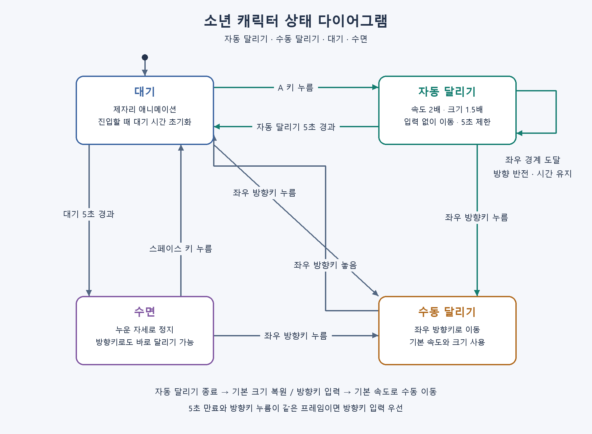
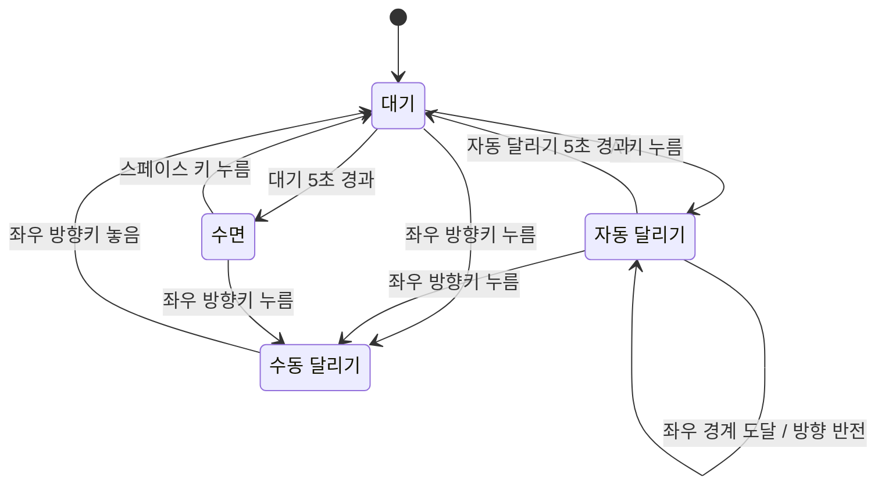

# 소년 캐릭터 상태 다이어그램





## 상태별 동작

| 상태 | 코드 이름 | 동작 |
| --- | --- | --- |
| 대기 | `IDLE` | 제자리 애니메이션. 진입 시 시간을 초기화하고 5초 후 수면으로 전환한다. |
| 수동 달리기 | `RUN` | 업데이트당 5픽셀 이동. 기본 크기 100 × 100픽셀. 좌우 키 누름으로 방향을 갱신한다. |
| 자동 달리기 | `AUTO_RUN` / `AutoRun` 클래스 | 업데이트당 10픽셀 이동. 크기 150 × 150픽셀. 좌우 경계에서 반전한다. |
| 수면 | `SLEEP` | 누운 자세로 애니메이션을 멈춘다. |

## 자동 달리기 규칙

- 대기 상태에서 새로 A 키를 눌러야 시작한다. 직전 바라보던 방향을 계승한다.
- A 키를 놓아도 달린다. A 키 반복 입력과 위·아래 방향키는 타이머를 바꾸지 않는다.
- 확대된 크기에 맞춰 중심 x 좌표를 75~725로 제한한다. 진입 시에도 위치를 보정한다.
- 경계에서는 실제 상태 재진입 없이 위치와 방향만 바꾸므로 타이머가 유지된다. 도식의 자기 전환은 이 동작을 나타낸다.
- 좌우 방향키를 누르면 기본 크기로 복원하고 그 방향의 수동 달리기로 전환한다.
- 단조 시계로 진입 후 5초가 지나면 기본 크기의 대기로 복귀한다. 대기의 수면 타이머도 새로 시작한다.
- 입력을 먼저 처리하므로 방향키 누름과 만료가 같은 프레임에 발생하면 수동 달리기가 우선한다.
- A를 계속 누른 채 만료되어도 자동으로 재진입하지 않는다. 놓았다가 다시 눌러야 한다.

## 다이어그램 재생성

게임 실행 의존성과 별도로 Pillow와 Windows 맑은 고딕 글꼴이 필요하다.

```powershell
python -m pip install Pillow
python tools/render_state_diagram.py
```

생성 파일: `images/state_machine.png` (1800 × 1320픽셀).
